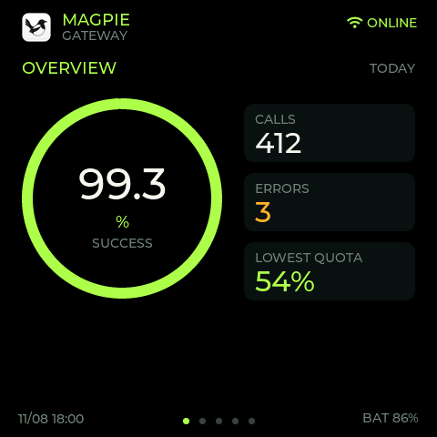
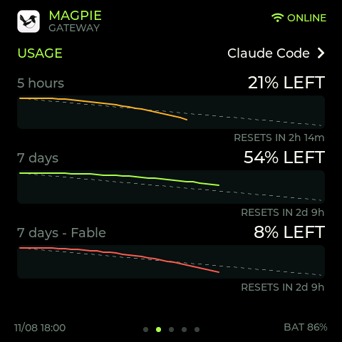
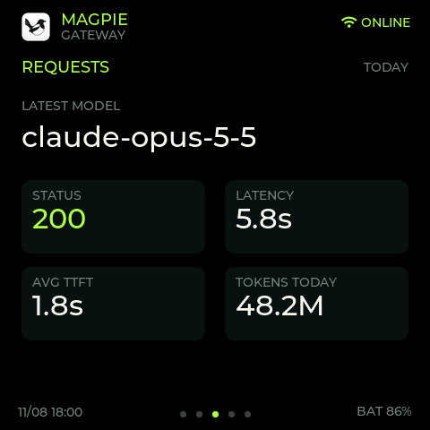
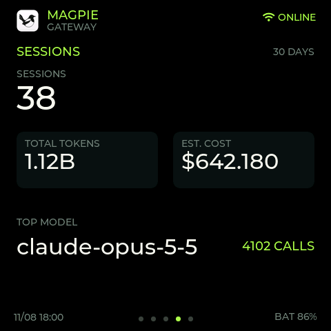
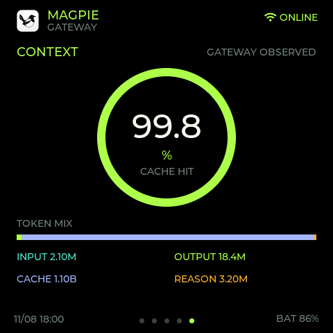
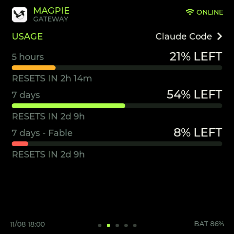

# magpie-companion

Shows a [Magpie](https://github.com/yetone/magpie) gateway's usage and health on
a Waveshare ESP32-S3-Touch-AMOLED-2.16. Built on the UI of
[peterroe/magpie-usage-display](https://github.com/peterroe/magpie-usage-display),
but the board polls Magpie itself over Wi-Fi. There is no macOS companion and
no BLE, so Magpie can run anywhere on the LAN, e.g. in Docker on a VM.

> Unofficial community project, not affiliated with Magpie.

```text
Magpie in Docker  http://<docker-vm>:3425
  ├─ /v1/magpie/quotas
  ├─ /v1/magpie/quotas/history?days=8
  ├─ /v1/magpie/usage
  └─ /v1/magpie/usage/requests?limit=1&via=through
            ^
            |  HTTP + gateway key, every 15 s
            |
  ESP32-S3 + LVGL + AMOLED (Wi-Fi)
```

## Pages

| Overview | Usage | Requests |
|---|---|---|
|  |  |  |
| **Sessions** | **Context** | **Usage (bars)** |
|  |  |  |

Rendered from the firmware's own UI code with sample data
(`tools/screenshot/build.sh` regenerates them).

- **Overview**: success rate, calls, errors, lowest remaining quota (today)
- **Usage**: one account's quota windows (5 hours, 7 days, ...) with % left,
  time to reset and a trend over the current cycle: the solid line is % left
  as Magpie read it (100% assumed at the start, as Magpie may first read it
  hours later), the dashed one even use (100% at the start, 0% at the
  reset). Below the dashed line means ahead of pace. Tap the page to switch
  between these trends and plain bars of % left, or the account name at the
  top right for the next account; both choices are remembered. Accounts
  without a percentage quota (prepaid balances such as OpenRouter) aren't
  listed.
- **Requests**: latest model, status, latency, average TTFT, today's tokens
- **Sessions**: 30-day sessions, total tokens, estimated cost, top model
- **Context**: cache hit rate and the input/output/cache/reasoning token mix

Status shows `WPS` (waiting for the router's WPS button), `ONLINE`,
`SYNCING` (Wi-Fi up, no data yet), `STALE` (no new
data for 60 s) or `OFFLINE` (Wi-Fi down or Magpie's last answer failed; a
toast says why, e.g. `MAGPIE HTTP 401`). Tap the status to reconnect.

## 1. Prepare Magpie

The Docker image listens on `0.0.0.0:3425`, so callers from other machines
need an enabled gateway key.

1. Publish the port on the VM: `-p 3425:3425` (or `ports: ["3425:3425"]`).
2. Create a read-only key for the display (Magpie `192d2ed` or newer). It
   can read quotas and usage but can't call any model. Don't add a budget,
   model or account limit: Magpie refuses a limited key the usage summary (403).

   ```sh
   docker exec <magpie-container> magpie gateway-key add "Magpie Display" --read-only
   ```

   An existing key: `magpie gateway-key access <id> read-only`.
3. Check it from another computer on the LAN:

   ```sh
   curl -H "Authorization: Bearer sk-magpie-..." http://<docker-vm-ip>:3425/v1/magpie/usage
   ```

The "today" figures follow Magpie's own clock. Set the container's `TZ`
(e.g. `-e TZ=Asia/Shanghai`) if today should roll over at local midnight.
If Magpie has an allow list of addresses, add the board's IP to it.

## 2. Configure

```sh
cp src/secrets.example.h src/secrets.h
```

Fill in `MAGPIE_URL` (the VM's LAN IP and published port), the gateway key,
and a POSIX `TIMEZONE` for the clock. `src/secrets.h` is git-ignored.

Wi-Fi is set up with WPS, so no password goes in the firmware. On first boot
the status reads `WPS`: press your router's WPS button within 2 minutes. The
board joins (2.4 GHz only), saves the network, and rejoins it on every boot.
To move to another network, hold BOOT for 3 seconds and press that router's
WPS button.

## 3. Build and flash

```sh
python -m venv .pio-venv
.pio-venv/Scripts/activate      # macOS/Linux: source .pio-venv/bin/activate
pip install platformio
pio run -t upload               # add --upload-port COM5 if it picks the wrong port
pio device monitor              # logs: [net] status / GET ... failed
```

On Windows, run these in PowerShell or cmd: the ESP32 toolchain installer
refuses Git Bash/MSYS ("MSys/Mingw is not supported").

If no port shows up, hold the left BOOT button while plugging in USB,
release it after two seconds, and retry.

## Controls

| Position | Button | Action |
|---|---|---|
| Left | BOOT / GPIO0 | Short press toggles the screen; hold 3 seconds to start WPS |
| Center | PWR / AXP2101 | Hold 4 seconds to cut power |
| Right | IO18 | Short press cycles pages; hold 1 second for quick actions (Refresh, Rotate screen) |

**Rotate screen** turns the picture (and touch) a quarter turn each time;
the rotation is remembered.

Swipe left or right to switch pages; past the last page comes the first,
and the other way round. Touch or the right button wakes the
screen (a waking touch does nothing else), which sleeps after 15 seconds idle. While asleep it lights up for
10 seconds every 10 minutes. Polling continues while it's off. To spare the
AMOLED, the background is true black and each wake shifts the picture by up
to 3 px (9 positions), so static parts don't sit on the same pixels.

Colors: quota (Usage bars and trends, LOWEST QUOTA) is green from 30% left, amber from
10%, red below; the success ring is green from 95%, amber from 80%, red below.
The Usage page leaves out a 5-hour window that hasn't been used (100% left).

## Test

The snapshot math has a desktop test (needs `pio run` once to fetch ArduinoJson):

```sh
g++ -std=c++17 -I src -I .pio/libdeps/esp32-s3-touch-amoled-216/ArduinoJson/src \
    test/metrics_test.cpp src/magpie_metrics.cpp -o metrics_test && ./metrics_test
```

## Security

- The board stores the gateway key and (after WPS) your Wi-Fi password in flash. With a
  read-only key, anyone who extracts it can see your quotas, usage and
  request log (models, accounts, sessions) but can't spend anything. Give
  the display its own key and remove it in Magpie if the board is lost.
- Requests go over plain HTTP on your LAN.

## Changes from magpie-usage-display

- Wi-Fi (WPS) and HTTP to Magpie instead of BLE and a macOS companion; the
  pairing screen, BLE bond clearing and "Focus Magpie" action are gone.
- New Usage page with a provider picker, screen rotation, level colors,
  10-minute screen check-ins and AMOLED pixel shift.
- Fixes: LOWEST QUOTA no longer reads 0% for prepaid-balance or text-only
  quota windows; estimated cost no longer wraps past $4,294; the latest
  request skips imported session-log rows, which carry no HTTP status.

## License

MIT, see [LICENSE](LICENSE). Based on peterroe/magpie-usage-display, itself
based on jayyao97/codex-usage-display. See
[THIRD_PARTY_NOTICES.md](THIRD_PARTY_NOTICES.md). The Magpie name and logo
belong to their owner.
